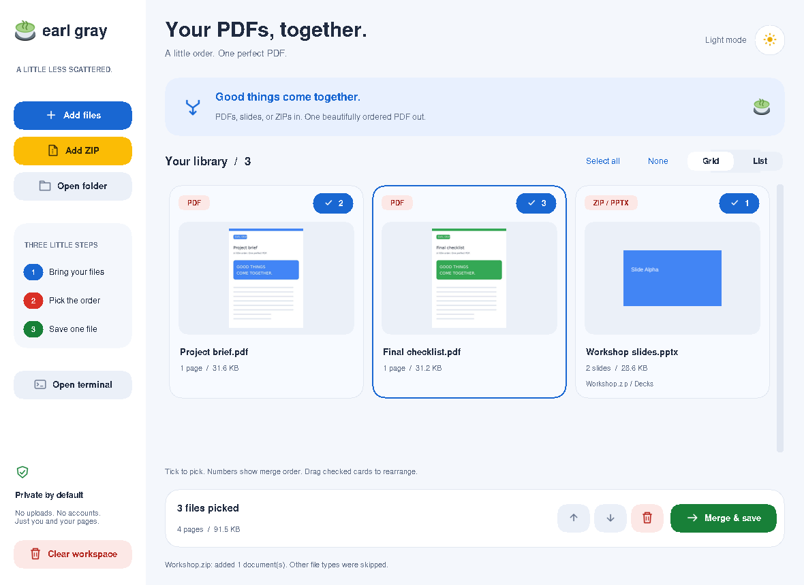
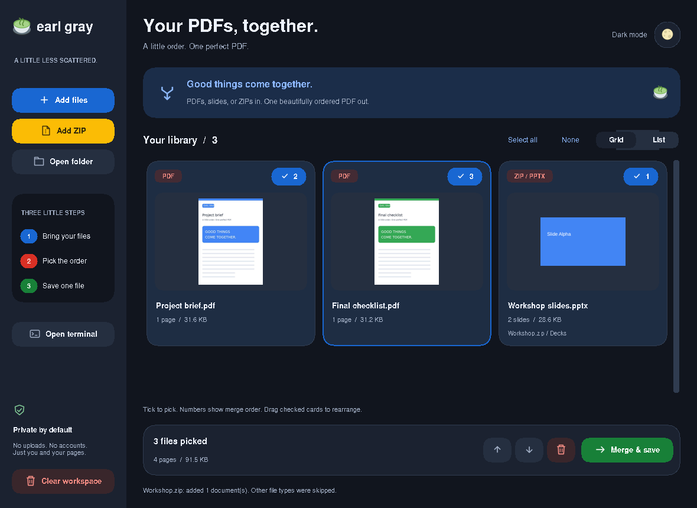
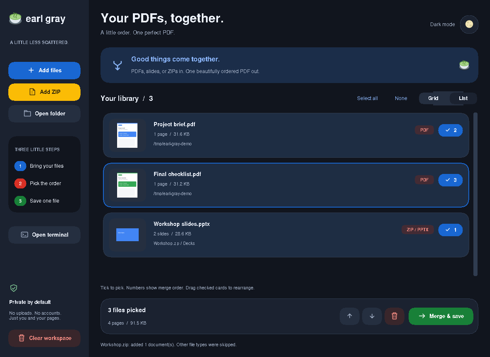

# Earl Gray

A little order. One perfect PDF.

A lightweight Python desktop app with rounded cards, Google-inspired colors, real PDF previews, and light/dark mode. Import PDFs, PowerPoint presentations, folders, or ZIPs, pick the order, and save one combined PDF. Everything stays on your computer.



## Run on Windows

Install Python 3.10 or newer from [python.org](https://www.python.org/downloads/windows/), with **Add Python to PATH** checked and **Tcl/Tk** included (the default). Close and reopen Command Prompt after installation.

Open the downloaded project folder in File Explorer, type `cmd` in its address bar, and press Enter. Run:

```bat
python -m pip install -r requirements.txt
python app.py
```

If your installation uses `py` instead of `python`, use `py` in both commands. Run these commands in the folder containing `app.py` and `requirements.txt`.

## Download without installing Python

After a push to `main`, the **Windows app** workflow tests the app and builds an executable on Windows. Open this repository's **Actions** tab, choose the latest successful **Windows app** run, and download **EarlGray-Windows** under **Artifacts** (GitHub sign-in required). Extract the ZIP and double-click `EarlGray.exe`.

The workflow must finish successfully before its download is available. The executable is unsigned; Windows may display a reputation warning.

## PowerPoint slides + PDFs

**PPTX import requires [LibreOffice](https://www.libreoffice.org/download/download-libreoffice/) (free) or installed Microsoft PowerPoint on Windows.** No extra Python packages are needed. Install one renderer, then restart Earl Gray. PDFs work without an office app.

Choose `.pptx` files with **Add files**, open a folder containing them, or add a ZIP containing PDFs and presentations. Each deck is converted locally in the background, then appears with its original filename, first-slide thumbnail, slide count, and source size. Pick it alongside PDFs and set the numbered order. All slides from a deck stay in presentation order; output is a single **PDF**, with static slide pages (no animations or transitions).

LibreOffice is used when installed; otherwise Windows uses PowerPoint automation. The app closes only the presentation it opened and restores PowerPoint's settings. It does not quit a pre-existing PowerPoint instance. Rendering depends on the fonts installed on your machine. Original presentations are never modified.

## Make a PDF

1. **Add files**, **Add ZIP**, or **Open folder**. Folder import includes PDFs and PPTXs directly inside the folder. ZIP import also finds both inside nested folders; other file types are skipped.
2. Switch between **Grid** and **List**. Both show first-page thumbnails, filenames, page counts, and sizes. Imported ZIP files also show their archive and subfolder.
3. Click **Pick** on each document you want. The checkmark and number show the exact merge order. Picking another document appends it; unpicking closes the gap. **Select all** appends all readable, loaded documents in library order.
4. Click a card to focus it, then use the up/down arrows to move it earlier/later. You can also drag a picked card onto another picked card. The library stays in import order while the numbers show output order.
5. Click **Merge & save**, choose a name and location in the native Save As dialog, and save. Existing destinations require overwrite confirmation. Source PDFs, presentations, and imported ZIPs cannot be overwritten.

The circular theme button shows a **sun in Light mode** and a **full moon in Dark mode**. Click it to switch themes. The tea emoji is used in the sidebar, title bar/taskbar, and Windows executable. Your selection and merge order stay intact when switching themes or views.

The red trash button removes the focused card; **Clear workspace** removes all cards. Locked, empty, and unreadable PDFs show an error and cannot be picked. Unlock password-protected PDFs and ZIPs with another tool before importing them.

## ZIP import

ZIPs are unpacked in the background into app-owned temporary storage, leaving the original archive unchanged. Original PDF/PPTX names are displayed even when several subfolders contain the same filename. Imported documents remain available for the session; temporary storage is removed when the app closes. Re-adding the same archive does not duplicate its documents while they remain in the library. Nested ZIP archives are skipped.

Each ZIP can contain up to 2,000 documents, with a maximum of 256 MB per document and 512 MB of extracted document data in total. Unsafe paths and document symlinks are rejected. Corrupt archives fail without changing your existing library.

## Open terminal / debugging

Click **Open terminal** to open a separate window with live session logs. On Windows it opens PowerShell in a new console, showing imports, slide-conversion output, loaded page counts, merge order, save results, and exception tracebacks. It remains available during conversion and merging. Closing the terminal leaves the app running.

Logs are retained after closing Earl Gray. On Windows they are saved under `%LOCALAPPDATA%\EarlGray\logs`; on Linux/macOS the temporary directory's `EarlGray/logs` folder is used. Logs include the document paths you process; no environment or credential dumps are recorded.

## Dark mode



## List view



## Build a Windows executable

Build on Windows:

```bat
python -m pip install -r requirements.txt pyinstaller==6.16.0
python -m PyInstaller --noconfirm --clean --onefile --windowed --collect-all pypdfium2 --collect-all customtkinter --hidden-import PIL._tkinter_finder --add-data assets:assets --icon assets/earl-gray.ico --name EarlGray app.py
```

The result is `dist\EarlGray.exe`. `--collect-all customtkinter` includes the theme and font resources needed by the rounded interface. Recipients do not need Python. PPTX conversion still requires LibreOffice or PowerPoint; the renderer is not bundled. Test a Windows build on Windows before distribution.

## Development

Built with CustomTkinter, Pillow, pypdf, and PDFium. ZIP support uses Python's standard library. PDF inspection, rendering, extraction, and merging run on one background worker; the UI remains responsive. Failed merges preserve existing output. Tk images and cyclic garbage collection are cleaned up on the UI thread.

For an isolated environment:

```bat
python -m venv .venv
.venv\Scripts\python -m pip install -r requirements.txt
.venv\Scripts\python app.py
.venv\Scripts\python -m unittest discover -s tests -v
```

On Linux/macOS, create the environment with `python3 -m venv .venv` and use `.venv/bin/python` for installation, running, and testing. Linux requires a Tk-enabled Python and a desktop display; the distribution's `python3-tk` package may be needed.

The tests include a real two-slide PPTX fixture and verify rendered slide text and mixed PDF/PPTX order. Install a slide renderer to run those integration checks; they explicitly report a skip when no renderer exists.

The tests cover actual merges, preview rendering, numbered selection, themes, view switching, ZIP import, extraction limits, unsafe paths, cleanup, and saving through the desktop UI. Desktop tests require a display or Xvfb and explicitly report a skip when no display exists. The Windows workflow installs LibreOffice and runs the same suite before packaging, then checks that the packaged app opens and closes from outside the checkout before uploading the executable.

The tea artwork is Twemoji (CC BY 4.0); see [asset attribution](assets/NOTICE.md).
